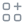
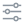
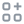

# DSH Icons

DeepSeek Harness 客户端 UI 图标的静态索引。每个图标下方是一个 `ts` 代码块，点右上角复制按钮就能拿到准确的组件名。

<!-- dsh-icons:begin meta -->
来源：`@deepseek-ai/dsh-client-ui-primitives@0.2.1-rc.4` · DSH `0.2.1-rc.4` · 95 Regular / 95 Medium

<!-- dsh-icons:end meta -->

## 怎么用

1. 在下面找到需要的图标。
2. 点变量名代码块右上角的复制按钮。
3. 粘进 prompt，或者直接 import：

```ts
import { IconAlarmClockOutlineRegular } from '@deepseek-ai/dsh-client-ui-primitives'
```

图标来自 npm 包 `@deepseek-ai/dsh-client-ui-primitives`，本仓库只做索引，不重新实现图标。

## 推荐

几个常用图标：

<!-- dsh-icons:begin recommended -->


*时间 / 定时*

```ts
IconAlarmClockOutlineRegular
```


*搜索 / 研究*

```ts
IconSearchOutlineRegular
```


*AI / 生成*

```ts
IconSparkleRegular
```


*文档 / 投递*

```ts
IconDeliverDocRegular
```


*浏览 / 公告*

```ts
IconBrowseOutlineRegular
```


*数据 / 存储*

```ts
IconDatabaseOutlineRegular
```


*文件夹*

```ts
IconFolderOpenOutlineRegular
```


*设置*

```ts
IconSettingsOutlineRegular
```

<!-- dsh-icons:end recommended -->

## Regular

1px 描边。

<!-- dsh-icons:begin regular -->


```ts
IconAgentPresetOutlineRegular
```


```ts
IconAlarmClockOutlineRegular
```


```ts
IconApiOutlineRegular
```



```ts
IconAppsAddOutlineRegular
```


```ts
IconArchiveCheckOutlineRegular
```


```ts
IconArchiveOffOutlineRegular
```


```ts
IconArchiveOutlineRegular
```


```ts
IconBranchOutlineRegular
```


```ts
IconBrowseOutlineRegular
```


```ts
IconCheckCircleFillRegular
```


```ts
IconCheckCircleOutlineRegular
```


```ts
IconCheckOutlineRegular
```


```ts
IconChecklistOutlineRegular
```


```ts
IconChevronDownOutlineRegular
```


```ts
IconChevronLeftOutlineRegular
```


```ts
IconChevronRightOutlineRegular
```


```ts
IconChevronUpOutlineRegular
```


```ts
IconChevronsUpDownOutlineRegular
```


```ts
IconClockOutlineRegular
```


```ts
IconCloseCircleFillRegular
```


```ts
IconCloseFillRegular
```


```ts
IconCloseOutlineRegular
```


```ts
IconCodeOutlineRegular
```


```ts
IconCompactOutlineRegular
```


```ts
IconCompareSplitOutlineRegular
```


```ts
IconContextInjectionOutlineRegular
```


```ts
IconCopyOutlineRegular
```


```ts
IconCordisPluginOutlineRegular
```


```ts
IconDarkOutlineRegular
```


```ts
IconDataOutlineRegular
```


```ts
IconDatabaseOutlineRegular
```


```ts
IconDeliverDocRegular
```


```ts
IconDislikeFillRegular
```


```ts
IconDislikeOutlineRegular
```


```ts
IconDownloadOutlineRegular
```


```ts
IconEditOutlineRegular
```


```ts
IconEllipsisOutlineRegular
```


```ts
IconEnhanceOutlineRegular
```


```ts
IconFlatListOutlineRegular
```


```ts
IconFolderCloseRegular
```


```ts
IconFolderOpenOutlineRegular
```


```ts
IconFolderOpenRegular
```


```ts
IconFollowsystemOutlineRegular
```


```ts
IconFullscreenOutlineRegular
```


```ts
IconGaugeOutlineRegular
```


```ts
IconGlobeOutlineRegular
```


```ts
IconGoalOutlineRegular
```


```ts
IconInfoOutlineRegular
```


```ts
IconInspectOutlineRegular
```


```ts
IconLightOutlineRegular
```


```ts
IconLikeFillRegular
```


```ts
IconLikeOutlineRegular
```


```ts
IconLinkOutlineRegular
```


```ts
IconListPenOutlineRegular
```


```ts
IconLoadingOutlineRegular
```


```ts
IconMicrophoneOutlineRegular
```


```ts
IconNewChatOutlineRegular
```


```ts
IconNowrapFillRegular
```


```ts
IconPanelLeftOutlineRegular
```


```ts
IconPaperPlaneOutlineRegular
```


```ts
IconPaperclipOutlineRegular
```


```ts
IconPauseOutlineRegular
```



```ts
IconPersonalizationOutlineRegular
```


```ts
IconPinFillRegular
```


```ts
IconPinOutlineRegular
```


```ts
IconPlanOutlineRegular
```


```ts
IconPlayOutlineRegular
```


```ts
IconPluginPinwheelOutlineRegular
```


```ts
IconPlusOutlineRegular
```


```ts
IconProjectAddOutlineRegular
```


```ts
IconQuestionOutlineRegular
```


```ts
IconQueueOutlineRegular
```


```ts
IconRefreshOutlineRegular
```


```ts
IconRightUpOutlineRegular
```


```ts
IconSearchOutlineRegular
```


```ts
IconSendOutlineRegular
```


```ts
IconSettingsOutlineRegular
```


```ts
IconShareOutlineRegular
```


```ts
IconShieldOutlineRegular
```


```ts
IconSkillOutlineRegular
```


```ts
IconSlidersTwoOutlineRegular
```


```ts
IconSparkleRegular
```


```ts
IconStopFillRegular
```


```ts
IconThinkOutlineRegular
```


```ts
IconTrashOutlineRegular
```


```ts
IconTreeCornerRegular
```


```ts
IconTriangleRightFillRegular
```


```ts
IconUnarchiveOutlineRegular
```


```ts
IconUserOutlineRegular
```


```ts
IconUsersOutlineRegular
```


```ts
IconWarningOutlineRegular
```


```ts
IconWarningTriangleOutlineRegular
```


```ts
IconWorkspaceTreeOutlineRegular
```


```ts
IconWrapFillRegular
```


```ts
IconWrapLinesOutlineRegular
```

<!-- dsh-icons:end regular -->

## Medium

1.3px 描边。

<details>
<summary>展开 Medium</summary>

<!-- dsh-icons:begin medium -->


```ts
IconAgentPresetOutlineMedium
```


```ts
IconAlarmClockOutlineMedium
```


```ts
IconApiOutlineMedium
```



```ts
IconAppsAddOutlineMedium
```


```ts
IconArchiveCheckOutlineMedium
```


```ts
IconArchiveOffOutlineMedium
```


```ts
IconArchiveOutlineMedium
```


```ts
IconBranchOutlineMedium
```


```ts
IconBrowseOutlineMedium
```


```ts
IconCheckCircleFillMedium
```


```ts
IconCheckCircleOutlineMedium
```


```ts
IconCheckOutlineMedium
```


```ts
IconChecklistOutlineMedium
```


```ts
IconChevronDownOutlineMedium
```


```ts
IconChevronLeftOutlineMedium
```


```ts
IconChevronRightOutlineMedium
```


```ts
IconChevronUpOutlineMedium
```


```ts
IconChevronsUpDownOutlineMedium
```


```ts
IconClockOutlineMedium
```


```ts
IconCloseCircleFillMedium
```


```ts
IconCloseFillMedium
```


```ts
IconCloseOutlineMedium
```


```ts
IconCodeOutlineMedium
```


```ts
IconCompactOutlineMedium
```


```ts
IconCompareSplitOutlineMedium
```


```ts
IconContextInjectionOutlineMedium
```


```ts
IconCopyOutlineMedium
```


```ts
IconCordisPluginOutlineMedium
```


```ts
IconDarkOutlineMedium
```


```ts
IconDataOutlineMedium
```


```ts
IconDatabaseOutlineMedium
```


```ts
IconDeliverDocMedium
```


```ts
IconDislikeFillMedium
```


```ts
IconDislikeOutlineMedium
```


```ts
IconDownloadOutlineMedium
```


```ts
IconEditOutlineMedium
```


```ts
IconEllipsisOutlineMedium
```


```ts
IconEnhanceOutlineMedium
```


```ts
IconFlatListOutlineMedium
```


```ts
IconFolderCloseMedium
```


```ts
IconFolderOpenMedium
```


```ts
IconFolderOpenOutlineMedium
```


```ts
IconFollowsystemOutlineMedium
```


```ts
IconFullscreenOutlineMedium
```


```ts
IconGaugeOutlineMedium
```


```ts
IconGlobeOutlineMedium
```


```ts
IconGoalOutlineMedium
```


```ts
IconInfoOutlineMedium
```


```ts
IconInspectOutlineMedium
```


```ts
IconLightOutlineMedium
```


```ts
IconLikeFillMedium
```


```ts
IconLikeOutlineMedium
```


```ts
IconLinkOutlineMedium
```


```ts
IconListPenOutlineMedium
```


```ts
IconLoadingOutlineMedium
```


```ts
IconMicrophoneOutlineMedium
```


```ts
IconNewChatOutlineMedium
```


```ts
IconNowrapFillMedium
```


```ts
IconPanelLeftOutlineMedium
```


```ts
IconPaperPlaneOutlineMedium
```


```ts
IconPaperclipOutlineMedium
```


```ts
IconPauseOutlineMedium
```


```ts
IconPersonalizationOutlineMedium
```


```ts
IconPinFillMedium
```


```ts
IconPinOutlineMedium
```


```ts
IconPlanOutlineMedium
```


```ts
IconPlayOutlineMedium
```


```ts
IconPluginPinwheelOutlineMedium
```


```ts
IconPlusOutlineMedium
```


```ts
IconProjectAddOutlineMedium
```


```ts
IconQuestionOutlineMedium
```


```ts
IconQueueOutlineMedium
```


```ts
IconRefreshOutlineMedium
```


```ts
IconRightUpOutlineMedium
```


```ts
IconSearchOutlineMedium
```


```ts
IconSendOutlineMedium
```


```ts
IconSettingsOutlineMedium
```


```ts
IconShareOutlineMedium
```


```ts
IconShieldOutlineMedium
```


```ts
IconSkillOutlineMedium
```


```ts
IconSlidersTwoOutlineMedium
```


```ts
IconSparkleMedium
```


```ts
IconStopFillMedium
```


```ts
IconThinkOutlineMedium
```


```ts
IconTrashOutlineMedium
```


```ts
IconTreeCornerMedium
```


```ts
IconTriangleRightFillMedium
```


```ts
IconUnarchiveOutlineMedium
```


```ts
IconUserOutlineMedium
```


```ts
IconUsersOutlineMedium
```


```ts
IconWarningOutlineMedium
```


```ts
IconWarningTriangleOutlineMedium
```


```ts
IconWorkspaceTreeOutlineMedium
```


```ts
IconWrapFillMedium
```


```ts
IconWrapLinesOutlineMedium
```

<!-- dsh-icons:end medium -->

</details>

## 版本与更新

本仓库同一时间只保留一份快照，当前版本见上面的 meta 行。同步默认跟随 npm 的 `next` 通道：

- `next`：默认。DSH 目前处于 RC 阶段，图标以这个通道为准。
- `latest`：不要自动跟随。它可能落后于 `next`（例如 2026-10 时 `latest` 是 `0.2.1-rc.2`，而 `next` 是 `0.2.1-rc.4`）。
- `alpha`：暂不支持。`0.2.2-alpha` 起图标改成 document sprite + `<use>` 架构，需要另一套提取逻辑；等它进入 `next` 后再适配。

版本不是直接读 primitives 的 tag，而是沿 `@deepseek-ai/dsh → dsh-web-app → dsh-web-frontend → dsh-client-ui-primitives` 逐层解析；依赖不是精确版本或链路不一致时会直接失败。

需要本地重新生成时（Node.js 22.6+）：

```bash
npm run sync                         # 跟随 next
DSH_VERSION=0.2.1-rc.4 npm run sync  # 锁定版本
npm test                             # 校验图标和 README
```

GitHub Actions 的 `sync-icons` 支持手动选择 `next` / `latest`，也可以填入精确版本。`latest` 当前是旧版，手动切换会把快照退回去，第二天定时任务会再回到 `next`。

## 来源与许可证

- 数据源：`@deepseek-ai/dsh-client-ui-primitives`（MIT）。
- 图标在同步时从该包提取为 SVG，未做手工修改；只把 `currentColor` 换成 `#8b949e`，让它们在 GitHub 明暗主题下都可见。
- 本仓库以 MIT 许可证发布，见 [LICENSE](LICENSE)。

标记区块内的内容由 `npm run sync` 生成，请勿手工编辑。
